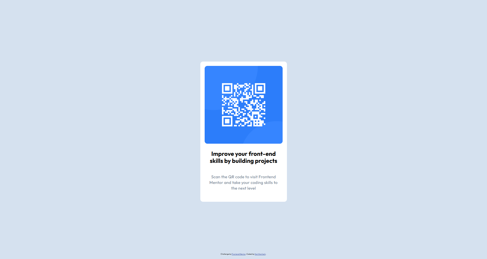

# Frontend Mentor - QR code component solution

This is a solution to the [QR code component challenge on Frontend Mentor](https://www.frontendmentor.io/challenges/qr-code-component-iux_sIO_H). Frontend Mentor challenges help you improve your coding skills by building realistic projects. 

## Table of contents

- [Frontend Mentor - QR code component solution](#frontend-mentor---qr-code-component-solution)
	- [Table of contents](#table-of-contents)
	- [Overview](#overview)
		- [Screenshots](#screenshots)
			- [Desktop](#desktop)
			- [Mobile](#mobile)
		- [Links](#links)
	- [My process](#my-process)
		- [Built with](#built-with)
		- [What I Learned](#what-i-learned)
		- [Useful resources](#useful-resources)
	- [Author](#author)

## Overview

The challenge was to build a small component consisting of a card with a QR code and provided copy. I have tried to replicate the design included in the figma. I have kept the attribution linking to Frontend Mentor even though it is not included in the design.

### Screenshots

#### Desktop

#### Mobile

### Links

- Solution URL: [Github Repository for Solution](https://github.com/kkanit22/FEM-1-1-qr_code)
- Live Site URL: [Live Deployment of Solution](https://kkanit22.github.io/FEM-1-1-qr_code/)

## My process

### Built with

- Semantic HTML5 markup
- Flexbox
- Mobile-first workflow

### What I Learned
- I was reminded of the influence of the often overlooked box-sizing css property and its importance in layout manipulation.

### Useful resources

- [CSS-Tricks Complete Css Flexbox Layout Guide](https://css-tricks.com/snippets/css/a-guide-to-flexbox/) - This is the best resource I have found when I have any questions about using flexbox and is always my first stop.

## Author

- Frontend Mentor - [@kkanit22](https://www.frontendmentor.io/profile/kkanit22)
